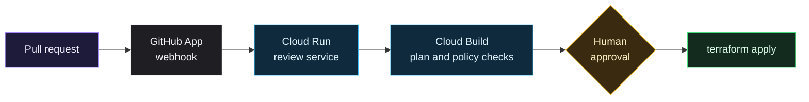

# Ahmed Brini

**Software Engineering Student · Cloud Security & Infrastructure Automation**

 

🟢 **Open to a capstone internship (PFE) starting January 2027, for 4 to 6 months, anywhere in the world.**

**Jump to:** [🧭 At a glance](#-at-a-glance) · [🧰 Stack](#-tech-stack) · [🚀 Projects](#-featured-projects) · [💼 Experience](#-experience) · [📊 Stats](#-github-stats) · [📫 Let's talk](#-lets-talk)

## 🧭 At a glance

**What I do**

I automate infrastructure and secure the delivery path on Google Cloud. Terraform provisions it, Ansible configures it and GitLab CI/CD ships to it, while scanners catch leaked secrets, Terraform misconfigurations and vulnerable images before anything is deployed.

**Studying**

Final-year software engineering student at the Mediterranean Institute of Technology (MedTech) in Tunis, in the Engineering Degree program of South Mediterranean University (SMU). Relevant courses: Pervasive Computing & Cloud, Cyber Security Assessment and Management.

**Looking for**

A 4 to 6 month capstone internship (PFE) starting January 2027, anywhere in the world. I'm open to relocation.

**Languages**

English (fluent), French (intermediate), Arabic (native).

**Off the keyboard**

Boxing, traveling and cafés with friends.

## 🧰 Tech stack

| | |
|---|---|
| **Cloud & DevOps** | GCP, Terraform, Ansible, GitLab CI/CD, Docker, Docker Hub, CI/CD, IaC, Policy as Code |
| **Security** | gitleaks, Checkov, Trivy, ansible-lint, Nikto, Sucuri |
| **Programming & tools** | Python, FastAPI, Flask, Git, Linux, GitHub Apps and webhooks, REST APIs |

## 🚀 Featured projects

### Secure CI/CD Delivery Pipeline on GCP

A push to `main` is tested, scanned for secrets, Terraform issues and image vulnerabilities, published to Docker Hub and, when the infrastructure is running, deployed to two Google Cloud VMs in under two minutes. The last full run with the VMs up, [pipeline #2911155655](https://gitlab.com/brinidev/gcp-delivery-pipeline/-/pipelines/2911155655), took 84 seconds end to end. The demo VMs are destroyed to avoid billing, so the deploy step is switched off.

```mermaid
flowchart LR
    push["git push<br/>to main"]:::you --> test["Lint and test"]:::ci --> sec["Secrets, Terraform and<br/>Ansible scans"]:::ci --> scan["Trivy image scan"]:::ci --> build["Build the image"]:::ci --> hub["Docker Hub<br/>tag = commit SHA"]:::reg --> deploy["Ansible deploy<br/>(off: VMs destroyed)"]:::ci --> live["2 GCP VMs<br/>health check 2 of 2"]:::live

    classDef you fill:#1e1b3a,stroke:#a78bfa,color:#ede9fe
    classDef ci fill:#2a1f0f,stroke:#fc6d26,color:#ffedd5
    classDef reg fill:#0f2a3d,stroke:#38bdf8,color:#e0f2fe
    classDef live fill:#132a1f,stroke:#4ade80,color:#dcfce7
```

- Automated delivery of a containerized FastAPI service to two GCP VMs with GitLab CI/CD: every push to `main` is tested, scanned, published to Docker Hub and deployed in under two minutes.
- Added security gates that fail the build on findings: gitleaks for secrets in the full git history, Checkov for Terraform, ansible-lint for playbooks and Trivy for the container image.
- Fixed the Checkov findings in the Terraform (Shielded VMs, project-wide SSH keys blocked), documented four accepted ones with reasons, and patched the image (no pip) to zero fixable high or critical vulnerabilities.
- Made deployments repeatable and safe to retry with idempotent Ansible roles that run the exact image tagged with the commit SHA and confirm each release with a health check.

[**Source on GitHub**](https://github.com/sinex-cloud/gcp-delivery-pipeline) · [**View on GitLab**](https://gitlab.com/brinidev/gcp-delivery-pipeline) · [**Pipeline history**](https://gitlab.com/brinidev/gcp-delivery-pipeline/-/pipelines) · [**Image on Docker Hub**](https://hub.docker.com/r/brinidev/gcp-delivery-pipeline)

### GCP Infrastructure Automation with Terraform

Every Terraform change is checked by code first, then approved by a human before anything is applied. A GitHub App triggers a Cloud Run service on every pull request, which runs plan and policy checks through Cloud Build and posts the result as a PR comment.

- Automated Terraform plan review with a GitHub App that triggers a Cloud Run service on every pull request, runs policy checks that block risky changes such as `roles/owner` IAM grants through the Cloud Build API, and requires human approval before any apply.
- Let routine changes (a new dataset, bucket or IAM permission) be made in a YAML file instead of Terraform code, with reusable BigQuery, Cloud Storage and IAM modules.
- Made one part of the shared foundation upgradeable without touching the rest by versioning modules with Git tags and pinning each component to its own release.

`infrastructure-terraform-gcp` holds the review pipeline. `gcp-foundation-module` holds the reusable Terraform modules it builds on: BigQuery, Cloud Storage, IAM and Cloud Run agent hosting, versioned with Git tags so each component upgrades on its own.

### Everything else

| Project | What it does |
|---|---|
| **[personal-portfolio](https://github.com/sinex-cloud/personal-portfolio)** | My portfolio site at [ahmedbrini.vercel.app](https://ahmedbrini.vercel.app/). Plain HTML, CSS and JavaScript. Its hero replays the real pipeline run from the first project. |

## 💼 Experience

| When | Role | What I did |
|---|---|---|
| **Jul. 2025 - Aug. 2025** | **Machine Learning Intern**, PwC Tunisia | Built the MLOps pipelines for fine-tuning Gemma language models on finance question answering, covering dataset preparation, training, checkpoint management and evaluation, with experiments tracked in MLflow. |
| **May 2024 - Jun. 2024** | **Security & Web Audit Intern**, Preventis | Audited a company website for security, performance and GDPR compliance with Nikto, Sucuri, WhatWaf, GTmetrix and Lighthouse. Found missing security headers, session cookies without HttpOnly and exposed server details, and presented the report to the company and the university. |
| **Jun. 2023 - Jul. 2023** | **Software Engineering Intern**, Wimbee Beyond Expertise | Built an end-to-end LSTM stock-price forecasting pipeline (preprocessing, feature engineering, training, evaluation), served through FastAPI with a Flask dashboard and live backtest. |

## 📊 GitHub stats

## 📫 Let's talk

I'm looking for a **capstone internship (PFE) in Cloud Security & Infrastructure Automation**, starting January 2027 for 4 to 6 months, anywhere in the world. Email is the fastest way to reach me: [ahmed.brini.abr@gmail.com](mailto:ahmed.brini.abr@gmail.com).
